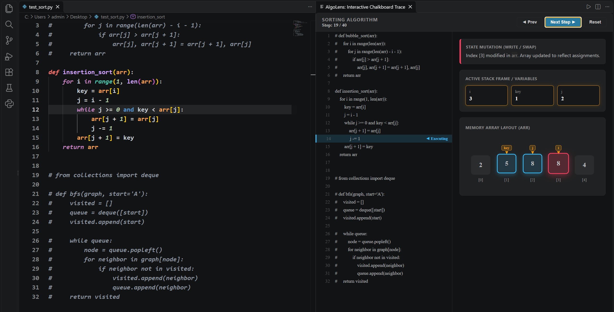
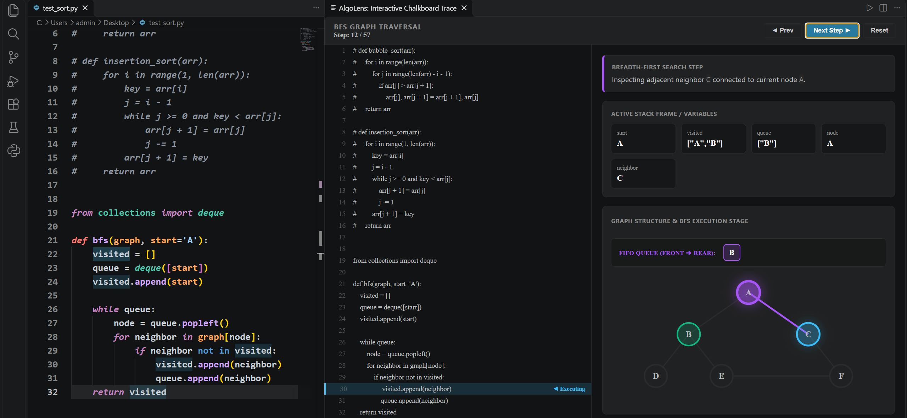

# Mayur Patel's AlgoLens 🔍

**AlgoLens** is an interactive execution tracer and visual algorithm chalkboard for Visual Studio Code.

Instead of staring at terminal print statements or setting breakpoints in a debugger, AlgoLens turns your Python code into an interactive, side-by-side walkthrough that visually illustrates what the algorithm is doing at each step.

---

## Visual Previews

### 1. Array & Sorting Visualization (Insertion Sort, Bubble Sort)
Track pointers (`i`, `j`), in-flight values (`key`), and watch memory updates pulse in red as shifts or swaps occur.



- **Synchronized Line Highlighting**: Follows source code execution line by line.
- **Dynamic Pointer Indicators**: Overhead tags hover directly above active index positions.
- **State Mutation Alerts**: Explains assignments and shifts in plain English.

---

### 2. Graph & Tree Traversal (Breadth-First Search)
Watch nodes light up as they are visited and observe elements entering and leaving the internal queue in real time.



- **Interactive Node States**: Nodes change state visually between current (purple glow), neighbor under evaluation (blue glow), and visited (green).
- **FIFO Queue Strip**: Displays elements entering and leaving `collections.deque` (`Front ➔ Rear`).
- **Pedagogical Observations**: Details every queue pop and adjacency inspection.

---

## Getting Started

### Prerequisites
- **Visual Studio Code** (`v1.85.0` or higher)
- **Python 3** installed and accessible on your system `PATH`

### How to Use

1. Open a `.py` file containing an algorithm function (e.g., `bubble_sort`, `insertion_sort`, or `bfs`).
2. Open the Command Palette:
   - **Windows / Linux:** `Ctrl + Shift + P`
   - **macOS:** `Cmd + Shift + P`
3. Type and select:
   ```text
   AlgoLens: Visualize Algorithm